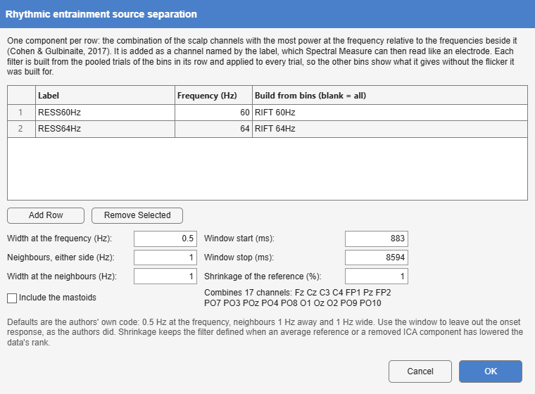

*Tools > 4. Frequency and Component Analysis > RESS · epoched, with bins →
the same, with added channels · `RESS`*

Rhythmic entrainment source separation [@cohen2017]. A tagged response is
usually read from the electrode where it looks strongest, a choice that
differs between people and frequencies and is circular when made on the
response itself. RESS replaces it with a spatial filter per recording and
frequency: the weighting of all scalp channels whose power at the
stimulation frequency is largest relative to the frequencies beside it. Each
filter is added as a channel (`RESS60Hz`), so that everything downstream,
Spectral Measure's coherence to a photodiode, SNR and ITC, reads it like an
electrode.

{#fig-ress-dialog}

| Option | Default | Meaning |
|---------------------------------------|-----------|-------------------------------------------------------|
| rows: **Label**, **Frequency**, **Build from bins** | | One component per row, built from the pooled trials of the listed bins (blank: all). |
| **Width at the frequency** | 0.5 Hz | FWHM of the narrow Gaussian filter at the frequency. |
| **Neighbours, either side** | 1 Hz | Distance of the reference frequencies. |
| **Width at the neighbours** | 1 Hz | FWHM of the filters at the neighbours. |
| **Window start**, **Window stop** | whole epoch | The samples entering the covariances, to leave out the onset response. |
| **Shrinkage of the reference** | 1% | Regularisation of the reference covariance (below). |
| **Include the mastoids** | off | Include mastoid channels among the scalp channels combined. |

: RESS's options. The defaults are those of the authors' code. {#tbl-ress}

**The method.** Two channel covariance matrices are formed from the same
samples: **S** from the data filtered narrowly at the frequency, and **R**
as the mean of the covariances at the frequency minus and plus the
neighbour distance. The generalised eigenvector of (S, R) with the largest
eigenvalue maximises the ratio of power at the frequency to power beside
it. The filters are Gaussians in the frequency domain, applied to the whole
epoch before the window is taken. The forward model (the component's scalp
map) is $S\mathbf w / (\mathbf w^\top S \mathbf w)$, and the sign is fixed so
that the largest element of the map is positive; unlike the reference code,
the weights are flipped with it, so that the component's phase, and its
phase lag to a photodiode, is not arbitrary.

**Shrinkage.** An average reference, an interpolated channel or a removed
ICA component lowers the rank of the data, and a singular R has no
well-defined generalised eigenvectors. R is therefore shrunk towards a
multiple of the identity, $(1-g)R + g\,\overline{\lambda}(R)\,I$; 0 reproduces
the article, which used full-rank data.

**Which trials.** A filter built from every condition at a frequency compares
those conditions fairly, because none had the filter fitted to it alone, as
the authors advise. The component is then computed for every trial, so it is
also applied to the bins it was not built from, and those are its null: what
the filter gives where its flicker was absent. A recording without a row's
bins gets that component as all-missing, with a note, so that every
recording keeps the same channels.

Only scalp EEG channels are combined, never eye channels, a photodiode or an
earlier component; running RESS again replaces its channels. The weights,
maps and eigenvalues are kept for the report.

), with the 50 Hz line noise largely gone.](images/ress-result.jpg){#fig-ress-result}

**Toolbox or own code.** No toolbox implements RESS. Alakazam's follows
Cohen and Gulbinaite's own script [@cohen2017] and reproduces its filters to
ten decimals.
